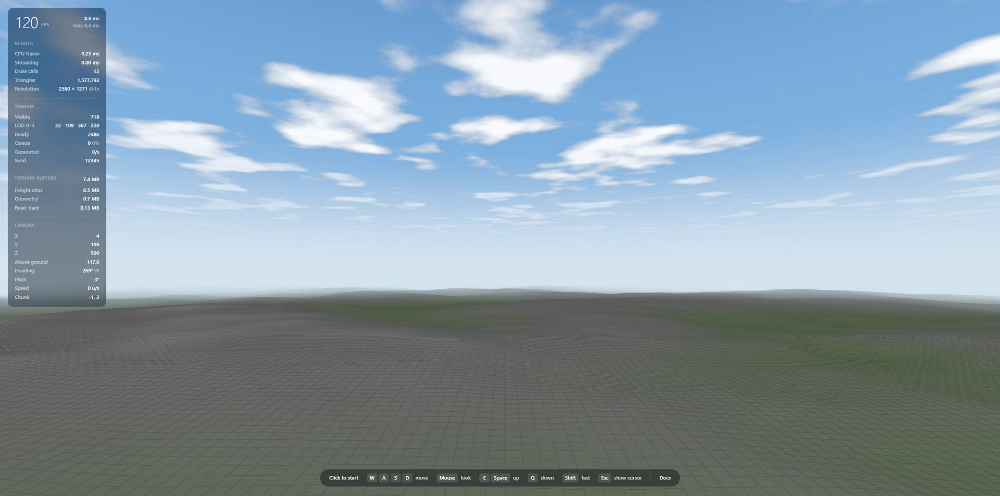

<p align="center">
  
</p>

<h1 align="center">Procedural WebGPU Terrain Engine</h1>

<p align="center">
  
  
  
  
  
  <a href="LICENSE">
    
  </a>
</p>

<p align="center">
  <a href="https://pgomur.github.io/ng-terrain-procedural/"><b>Live Demo</b></a> ·
  <a href="https://pgomur.github.io/ng-terrain-procedural/docs/"><b>API Documentation</b></a>
</p>

<p align="center">
  
</p>

An infinite procedural terrain that is generated, streamed and rendered on the GPU with WebGPU compute shaders written in Three.js Shading Language (TSL), hosted in a zoneless Angular application.

## Architecture

### Streaming and level of detail

- The world is a grid of square chunks (`CHUNK_SIZE`). Every chunk within `1.2 × max(LOD_DISTANCES)` of the camera is wanted, with a level of detail chosen by distance (four rings, LOD 0 to 3).
- Missing chunks wait in a bounded priority queue (an indexed binary heap). Their score is the distance to the camera minus a look-ahead along the camera velocity, so chunks in the direction of travel are generated first. Requests that stop being wanted are dropped before they reach the GPU.
- When a chunk changes LOD, the old version stays on screen until its replacement is ready. Chunks that leave the area are released after `UNLOAD_DELAY_MS`, or at once while more than `MAX_CHUNKS` are held. Failed generations are retried with exponential backoff.

### GPU generation

- Heights live in a height atlas: one storage buffer page per resolution, sized from the expected number of chunks of that LOD, with one slot per chunk. Extra pages are only created if the working set outgrows the estimate.
- Each frame, up to `GENERATION_BUDGET` chunks are generated with one batched compute dispatch per page. The kernel evaluates fractional Brownian motion over MaterialX Perlin noise (optional domain warping) and, in the same pass, the exact minimum and maximum height of every chunk with atomic operations.
- The compute work is submitted to the same queue before the frame is rendered, so a chunk is drawn in the frame it is generated. Nothing waits for the GPU.
- Only two small read-backs remain, both asynchronous: the per-chunk bounds (8 bytes per chunk, batched) used for culling, and the heights of the 3 × 3 chunks around the camera used for collision, which are bit-identical to what is rendered.
- Compute kernels, page materials and shadow pipelines are compiled during initialisation, behind the loading screen.

### Rendering

- One `InstancedMesh` per atlas page. A shared grid per resolution is displaced in the vertex shader, which reads the chunk's heights from the storage buffer; per-instance data carries the chunk origin, its atlas slot and a seam code.
- Chunk resolutions are `2^n + 1` (65, 33, 17, 9), so the edge vertices of neighbouring LODs line up. The vertex shader moves the edge vertices of the finer chunk onto the coarser neighbour's edge, and short skirts drawn with a polygon offset hide any remaining rasterisation pinholes.
- Chunks are culled on the CPU against the camera frustum with their exact bounds; instance buffers are rebuilt only when visibility or the chunk set changes.
- Shadows come from a directional light whose shadow camera follows the camera and is snapped to the shadow-map texel grid. Shadow casters are a separate per-page instance list limited to the shadow region, independent of camera visibility.
- The sky is procedural (`shaders/sky.tsl.ts`): a horizon-to-zenith gradient, a sun disk and glow aligned with the directional light, and drifting fBm clouds whose edges are anti-aliased with screen-space derivatives, so they stay sharp up close without flickering near the horizon. It is drawn as a dome on the far plane after the terrain, so only the sky pixels that are actually visible are shaded.
- Fog is radial and fully opaque at the edge of the loaded area, so the end of the world is never visible. Its colour is the cloudless sky in the same view direction, so distant terrain dissolves into the horizon.

### Application

- Zoneless Angular with signals and `OnPush`. The engine and Three.js are loaded lazily with `@defer`, keeping the initial bundle small.
- A single `requestAnimationFrame` loop runs input, streaming and rendering in that order. Diagnostics are published to the UI four times per second: frame rate, average and worst frame time, CPU time per frame and for streaming, draw calls, triangles, render resolution, visible chunks per LOD, loaded and queued chunks, generation rate, GPU buffer sizes of the height atlas, terrain geometry and read-back staging, and the camera's position, height above ground, heading, pitch, speed and chunk.
- If WebGPU is not available the app explains why instead of starting. If the GPU device is lost while running (a driver reset or a GPU timeout), the frame loop stops, pending read-backs are not retried, the cursor is released and a message asks to reload the page.

## Documentation

The public API is documented with [TSDoc](https://tsdoc.org) comments, and [TypeDoc](https://typedoc.org) turns them into the [API documentation](https://pgomur.github.io/ng-terrain-procedural/docs/), published next to the demo and linked from its controls bar. TypeDoc runs in CI with its warnings treated as errors, so an undocumented export or a broken `{@link}` fails the build.

Besides the API reference, the documentation includes guides that explain how the engine works:

| Guide | Covers |
| --- | --- |
| [Architecture](guides/architecture.md) | The pieces, start-up, the frame loop step by step, and the life of a chunk. |
| [Streaming and levels of detail](guides/streaming.md) | Which chunks are wanted, priorities, lifecycle, retries, culling and collision. |
| [GPU height generation](guides/gpu-generation.md) | The height atlas, compute dispatches, the noise, exact bounds and read-backs. |
| [Rendering](guides/rendering.md) | Instanced draw calls, seams and skirts, materials, shadows, sky and fog. |
| [Configuration](guides/configuration.md) | Every option with its default, its cost and some recipes. |
| [Diagnostics panel](guides/diagnostics.md) | What each value of the panel measures and how to read it. |
| [Embedding the terrain](guides/embedding.md) | The component, the engine's signals, the controls and a custom camera. |

## Requirements

- A browser with WebGPU support. The renderer reads storage buffers in the vertex stage, which core WebGPU supports and WebGPU compatibility mode does not.
- Node.js `^22.22.3`, `^24.15` or `>= 26` to build.

## Getting started

```bash
npm ci
npm start
```

Open `http://localhost:4200`, click the terrain to capture the pointer and fly with:

| Input | Action |
| --- | --- |
| Mouse | Look around |
| `W` `A` `S` `D` | Move |
| `E` / `Space` | Up |
| `Q` | Down |
| `Left Shift` | Move three times faster |
| `Esc` | Show the cursor again |

The camera keeps a minimum height above the terrain.

## Scripts

| Command | Description |
| --- | --- |
| `npm start` | Development server |
| `npm run build` | Production build in `dist/ng-terrain-procedural/browser` |
| `npm test` | Unit tests with Vitest (`npx ng test --watch=false` for a single run) |
| `npm run lint` | ESLint (strict, type-checked) on TypeScript and templates |
| `npm run format` | Format the sources with Prettier |
| `npm run format:check` | Check formatting without changing files |
| `npm run docs` | API documentation with TypeDoc in `dist/ng-terrain-procedural/browser/docs` (run it after the build) |
| `npm run preview` | Production build plus documentation, served locally like GitHub Pages and opened in the browser |

## Configuration

Defaults are defined in `DEFAULT_TERRAIN_CONFIG` (`src/app/types/terrain.ts`). They can be replaced application-wide by providing the `TERRAIN_CONFIG` injection token, or per instance through the `configOverrides` input of `<app-terrain>`.

| Option | Default | Description |
| --- | --- | --- |
| `CHUNK_SIZE` | `128` | Chunk side length in world units |
| `CHUNK_RESOLUTIONS` | `65, 33, 17, 9` | Vertices per side for LOD 0 to 3 |
| `LOD_DISTANCES` | `600, 1500, 3000` | Upper distance of LOD 0, 1 and 2 |
| `GENERATION_BUDGET` | `16` | Chunks generated per frame |
| `GENERATION_QUEUE_CAPACITY` | `256` | Pending requests kept in the priority queue |
| `UNLOAD_DELAY_MS` | `960` | Milliseconds a chunk is kept after it stops being wanted |
| `MAX_CHUNKS` | `1024` | Soft limit that evicts the oldest unloading chunks first; below the default wanted set (about 2,485), so left chunks are released at once |
| `NOISE_SEED` | `12345` | World seed |
| `NOISE_OCTAVES`, `NOISE_PERSISTENCE`, `NOISE_LACUNARITY` | `4`, `0.5`, `2` | Fractional Brownian motion parameters |
| `NOISE_WARP_ENABLED` and `NOISE_WARP_*` | `false` | Domain warping |
| `TERRAIN_HEIGHT_SCALE`, `TERRAIN_OFFSET_Y` | `100`, `0` | Vertical scale and offset |
| `SEAM_FITTING_ENABLED` | `true` | Stitch edges between LODs (requires `2^n + 1` resolutions) |
| `ANTICIPATION_SECONDS`, `VELOCITY_WEIGHT` | `1`, `0.6` | Look-ahead time and weight used to prioritise generation |

## Project structure

```text
src/app/
  engine/
    terrain-engine.ts     Renderer, camera, scene, frame loop and initial loading
    sun-light.ts          Sun and ambient light, shadow camera snapped to the texel grid
    frame-stats.ts        Diagnostics collected per frame and published four times per second
    chunk-manager.ts      Streaming, chunk lifecycle, visibility and collision heights
    streaming-queue.ts    Bounded priority queue of chunks waiting to be generated
    camera-velocity.ts    Smoothed camera velocity used to look ahead
    gpu-generator.ts      Height atlas, batched compute dispatch and read-backs
    scene-graph.ts        Instanced batches, seams, visibility and shadow casters
    chunk-geometry.ts     Shared chunk grid with its four skirts
  shaders/
    elevation.tsl.ts      TSL kernels: noise, heights, bounds and vertex displacement
    terrain-material.tsl.ts  Terrain colouring and the surface and skirt materials
    sky.tsl.ts            Procedural sky shared by the sky dome and the fog
  math/
    chunk-coord.ts        Chunk keys, LOD selection, bounds, culling and seam stitching
  terrain/
    terrain.component.ts  Connects the engine to the page: canvas, loader, panel and controls
    hud.component.ts      Diagnostics panel
    fly-camera.ts         Keyboard and mouse flight controls with pointer lock
    terrain.config.ts     Injection token for the configuration
  ui/
    loader.component.ts   Loading and error screen shared by the app and the terrain
  types/                  Shared types, engine statistics and default configuration
src/testing/              CPU height generator used by the unit tests
guides/                   Guides published with the API documentation
assets/                   Images used by this README
```
